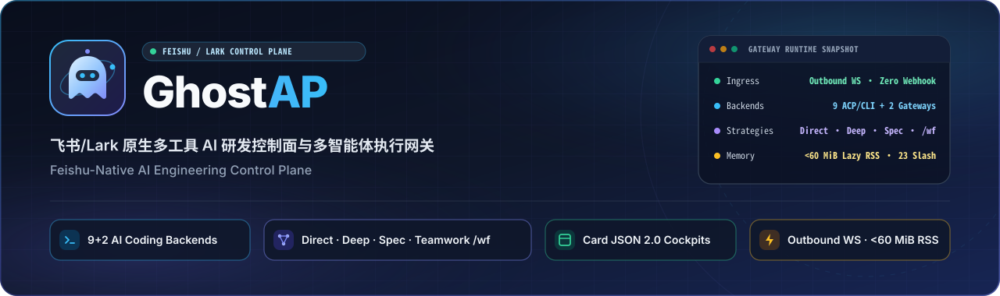
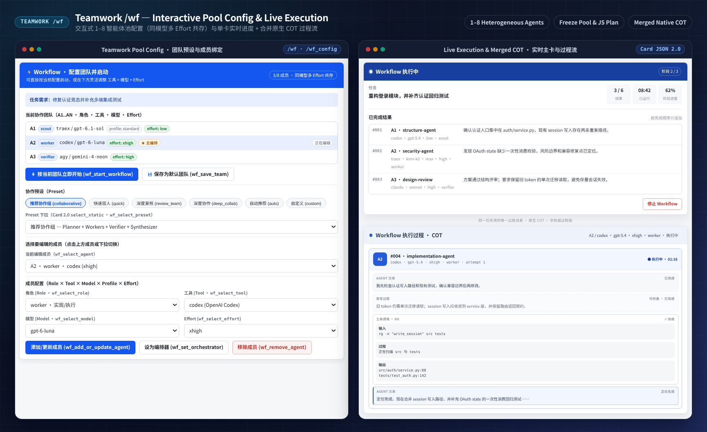
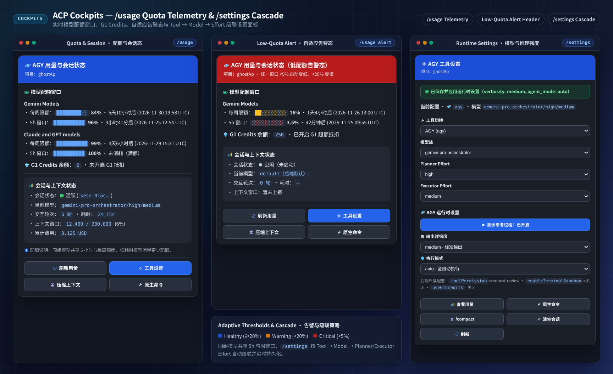
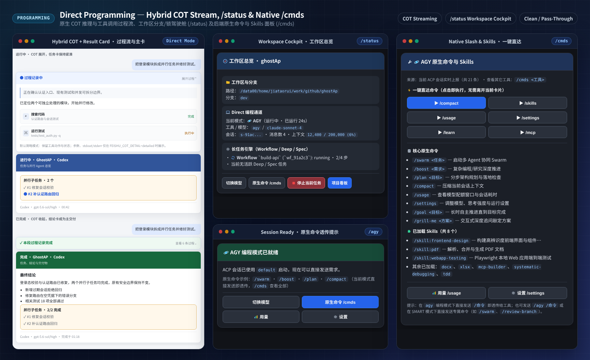
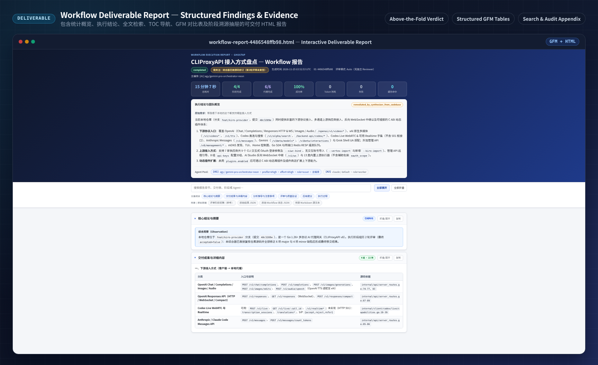
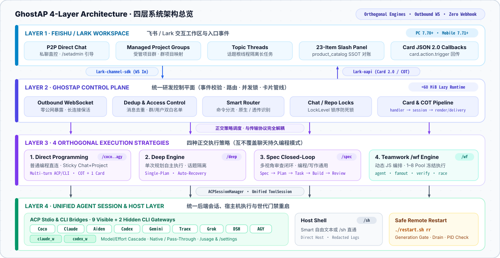
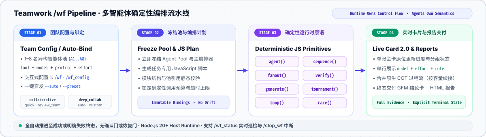

<p align="center">
  
</p>

<p align="center">
  <a href="CHANGELOG.md"></a>
  <a href="pyproject.toml"></a>
  <a href="LICENSE"></a>
  <a href=".github/workflows/ci.yml"></a>
  <a href="docs/adr-card-pipeline-boundary.md"></a>
  <a href="docs/product-contract.md"></a>
  <a href="install.sh"></a>
</p>

<p align="center">
  <strong>简体中文</strong> | <a href="README_EN.md">English</a>
</p>

<p align="center">
  <a href="#核心亮点">核心亮点</a> ·
  <a href="#界面画廊">界面画廊</a> ·
  <a href="#一键安装">一键安装</a> ·
  <a href="#飞书配置">飞书配置</a> ·
  <a href="#架构与多智能体">架构与多智能体</a> ·
  <a href="#命令速查">命令速查</a>
</p>

<p align="center">
  <a href="docs/assets/ghostap-avatar.png"></a>&nbsp;&nbsp;&nbsp;
  <a href="docs/assets/ghostap-icon.svg"></a>
  <br>
  <sub><b>Bot 头像（512×512 圆形裁切安全，可直接上传飞书开放平台）</b> · <b>矢量主标（SVG）</b></sub>
</p>

> **GhostAP** 是一个面向受信工程环境的飞书 / Lark 原生 AI 研发控制面与多智能体执行网关。**主 Bot** 作为统一控制面管理项目、受管群、直接编程会话及 Deep / Spec / Teamwork `/wf` 长任务引擎，同时将底层 **provider/transport**、模型与执行策略完全解耦；完整产品边界以 [产品合同](docs/product-contract.md) 为准。

---

## 核心亮点

| 维度 | 核心能力与工程特性 |
| :--- | :--- |
| **出站长连接，零公网暴露** | 基于飞书 **Outbound WebSocket**，无需公网 IP、域名或反向代理 Webhook，内网开发机与 macOS 工作站开箱即连。 |
| **9+2 AI 后端与原生 `/` 透传** | 统一驱动 `coco`、`claude`、`aiden`、`codex`、`gemini`、`traex`、`grok`、`dsh`、`agy`（及隐藏桥接 `claude-w`、`codex-w`）；`/cmds` 展示原生命令与 Skills，非任务斜杠命令零提示词污染透传。 |
| **四大正交执行引擎** | **Direct** 持久编程直连、**Deep** 单次规划自主执行、**Spec** 多角色闭环审查、**Teamwork `/wf`** 多 Agent JS 编排；引擎作用域隔离在话题/根线程，绝不覆盖聊天+项目编程状态。 |
| **Feishu Card 2.0 交互驾驶舱** | 原生提供 `/usage` 配额与 Credits 监控、`/settings` 工具/模型/思考档位级联驾驶舱、`/status` 工作区总览以及混合流式 COT 过程消息。 |
| **极简懒加载 `<60 MiB` 运行时** | `lark_oapi`、`lark_channel` 与重型引擎按需水合，零空载后台轮询，守护进程实测空载常驻约 `56.9 MiB` RSS / `3` 常驻线程。 |
| **Generation 门禁安全远程重启** | 支持在 Bot 会话内直接执行 `./restart.sh rr` 触发当前 checkout 重启，通过跨进程锁门禁、运行任务排空与 WebSocket 就绪指纹校验实现无损热切换。 |

---

## 界面画廊

<table width="100%">
  <tr>
    <td width="50%" align="center" valign="top">
      <a href="docs/assets/showcase-workflow.png"></a><br>
      <sub><b>Teamwork <code>/wf</code> 多智能体团队配置卡与实时编排进度</b></sub>
    </td>
    <td width="50%" align="center" valign="top">
      <a href="docs/assets/showcase-cockpit.png"></a><br>
      <sub><b><code>/usage</code> 配额条与 <code>/settings</code> 模型/思考档位级联驾驶舱</b></sub>
    </td>
  </tr>
  <tr>
    <td width="50%" align="center" valign="top">
      <a href="docs/assets/showcase-programming.png"></a><br>
      <sub><b>混合流式 COT 卡片、<code>/cmds</code> 原生命令面板与 <code>/status</code> 工作区总览</b></sub>
    </td>
    <td width="50%" align="center" valign="top">
      <a href="docs/assets/showcase-report.png"></a><br>
      <sub><b>Teamwork <code>/wf</code> 结构化 GFM / HTML 交付报告</b></sub>
    </td>
  </tr>
</table>

---

## 一键安装

### 环境前置要求

- **操作系统**：Linux 或 macOS
- **Python 3.11+** 与 **`uv`**（一键安装脚本与 `./restart.sh` 均支持在缺失时自动安装 `uv`）
- **Node.js 20+**（仅使用 `/wf` Teamwork 多 Agent 编排时需要）
- **飞书 / Lark 客户端**：如需使用客户端 Slash Command 面板，飞书 PC 端需 `7.70+`，移动端需 `7.71+`
- **本地 AI 工具**：按需安装并预先认证你要使用的后端 CLI / ACP Provider（如 `coco`、`claude`、`codex`、`gemini`、`agy` 等）

### 三种部署方式

#### 🚀 方式一：零前置一键脚本安装（推荐）

自动检测并按需安装 `uv` 与 Python 3.11+，同步虚拟环境并初始化 `0600` 权限 `.env`（详见 [install.sh](install.sh)）：

```bash
curl -fsSL https://raw.githubusercontent.com/22-ai-00/ghostAp/main/install.sh | bash
```

> **常用参数**：默认安装到当前 GhostAP 源码目录或 `~/ghostAp`（可用 `GHOSTAP_INSTALL_DIR` 覆盖）；支持 `--mode source|tool|wheel`、`--dir <目标路径>`、`--wheel <路径或URL>`、`--repo <Git地址>`、`--branch <分支>`、`--no-dev`（通过管道传参示例：`curl ... | bash -s -- --mode tool`）；设置 `GHOSTAP_AUTO_INSTALL_UV=0` 可禁用自动安装 `uv`。

#### 📦 方式二：安装包 / 全局 CLI（Wheel / `uv tool` / Releases）

从 [GitHub Releases](https://github.com/22-ai-00/ghostAp/releases) 获取 `.whl`、`install.sh` 与 `SHA256SUMS.txt`，或直接通过 Git / 一键 `--mode wheel` 安装为全局 `ghostap` CLI：

```bash
# 从 Release Wheel 安装（二选一）
uv tool install ghostap-*.whl
# 或 pipx install ghostap-*.whl

# 或通过 install.sh 自动拉取最新 Release Wheel / Git 源码全局安装
curl -fsSL https://raw.githubusercontent.com/22-ai-00/ghostAp/main/install.sh | bash -s -- --mode wheel
# 或直接 uv tool install git+https://github.com/22-ai-00/ghostAp.git

# 查看版本、初始化配置（0600 权限）、环境巡检并启动
ghostap --version
ghostap init          # 可选: --dir <目录> --force
ghostap doctor        # 可选: --dir <目录>
ghostap               # 或 ghostap run / ghostap validate
```

#### 🛠️ 方式三：源码克隆与守护脚本

```bash
git clone https://github.com/22-ai-00/ghostAp.git
cd ghostAp
./restart.sh install   # (或 bootstrap) 自动安装 uv（如缺失）、同步依赖并生成 .env
vim .env               # 填入 APP_ID 与 APP_SECRET
./restart.sh start     # 后台启动并等待飞书 WebSocket 就绪
```

> `./restart.sh` 在缺失 `uv` 时默认自动安装；如需在离线或受控环境中禁用，可设置 `GHOSTAP_AUTO_INSTALL_UV=0`。如需跳过启动前依赖检查，可设置 `GHOSTAP_SYNC_PYTHON_DEPENDENCIES=0`。

---

## 飞书配置

### 1. 飞书开放平台 5 分钟配置清单

在[飞书开放平台](https://open.feishu.cn/app)创建企业自建应用并完成以下配置：

1. 获取应用凭证 **`APP_ID`** 和 **`APP_SECRET`**。
2. 在 **事件与回调 → 事件配置** 中启用 **使用长连接接收事件**（无需公网回调 URL）。
3. 订阅消息事件：**`im.message.receive_v1`**。
4. 在 **回调订阅** 中**只保留**新版 **`card.action.trigger`**（卡片回传交互）；删除旧版 `card.action.trigger_v1` 或旧请求地址配置。GhostAP 仅收发 Card JSON 2.0（参考[飞书官方最新版说明](https://open.larkoffice.com/document/feishu-cards/card-callback-communication)）。
5. 开通消息接收、消息发送与卡片更新相关权限（含群聊与私聊读写）。
6. 开通 **`application:app_slash_command:read`** 和 **`application:app_slash_command:write`** 权限，随后**创建并发布应用新版本**。

> **小贴士（Bot 头像）**：你可以直接上传仓库内置的高清圆形安全区头像 [`docs/assets/ghostap-avatar.png`](docs/assets/ghostap-avatar.png) 作为飞书应用机器人头像（矢量源标见 [`docs/assets/ghostap-icon.svg`](docs/assets/ghostap-icon.svg)）。
>
> **Slash 面板对账说明**：服务启动后会自动将 `23` 项常用命令同步至主 Bot 面板（新建/更新后通常约 5 分钟生效，客户端缓存约 3 分钟）；未列在面板中的高阶命令与 `/workflow` 等别名仍可直接输入触发。

### 2. 配置 `.env`

若使用方式二通过 `ghostap init` 生成，或从源码复制模板：

```bash
cp .env.example .env && chmod 600 .env
```

最小必填配置：

```env
APP_ID=your_app_id
APP_SECRET=your_app_secret
DEFAULT_ACP_TOOL=coco
ADMIN_USER_IDS=
INGRESS_ACCESS_MODE=legacy_allow_all
ADMIN_BOOTSTRAP_SCOPE=p2p_only
```

常用调优参数（完整列表见 [`.env.example`](.env.example) 与 [`src/config/settings.py`](src/config/settings.py)）：

```env
COMMAND_TIMEOUT=30
COMMAND_MAX_OUTPUT_LENGTH=4000
ACP_MODEL_PROBE_TIMEOUT=15

WORKFLOW_TOTAL_TIMEOUT_S=3600
WORKFLOW_AGENT_CALL_TIMEOUT_S=600
WORKFLOW_SCRIPT_GEN_TIMEOUT_S=600

FEISHU_COT_ENABLED=true
FEISHU_COT_DETAIL=brief
```

- `INGRESS_ACCESS_MODE` 默认 `legacy_allow_all`，使当前应用接入的私聊与群聊可直接响应；需要用户与群双白名单隔离时改为 `enforced`。
- GhostAP 不在 Shell、ACP 或 Workflow 上叠加额外命令过滤或系统沙箱；各 AI 后端按各自原生权限模型处理执行请求。

### 3. 校验、启动与管理员引导

```bash
# CLI 全局方式
ghostap validate && ghostap

# 或源码 uv 方式
uv run python -m src.main --validate
uv run python -m src.main
```

首次启动后，在飞书**私聊机器人**发送 **`/setadmin`** 即可绑定首位管理员（仅当 `ADMIN_USER_IDS` 为空时允许单向引导；设置后仅现有管理员可变更）。

---

## 架构与多智能体

<p align="center">
  
</p>

### 运行模型与策略正交性

GhostAP 将产品身份、执行策略和底层 **provider/transport** 清晰分离：

| 维度 | 职责说明 |
| :--- | :--- |
| **产品身份** | **主 Bot** 作为统一控制面与消息交互入口，管理项目、受管群、任务调度、锁顺序与审计 |
| **执行策略** | 普通编程（Direct）、Deep、Spec、Workflow 四条正交通道；后三者作用于话题/根线程，不替换持续编程模式 |
| **provider/transport** | 统一覆盖 ACP Stdio（`coco`、`aiden`、`codex`、`gemini`、`traex`、`grok`、`dsh`、`agy`）与 CLI 桥接（`claude`、`claude-w`、`codex-w`） |
| **Host Shell** | 独立的宿主机直接执行能力（Smart 模式未匹配文本或任意模式 `/sh <命令>`），不是 Agent provider |

### Teamwork `/wf` 多智能体编排流水线

<p align="center">
  
</p>

- **交互配置与极速直达**：发送 `/wf <需求>` 会弹出 Teamwork 团队配置与启动卡，预填当前聊天/项目保存的团队或自动推荐的 **1–8 个 `tool+model` Agent**（含 `A1`–`A8`、`profile`/`effort`/`role`），支持一键启动或当次微调；发送 `/wf --auto <需求>` 或 `/wf --preset <id> <需求>` 可跳过配置卡直接开跑（内置预设：`collaborative`、`quick`、`review_team`、`deep_collab`、`auto`、`custom`）。
- **池绑定与全自动推进**：启动后系统**自动绑定**推荐或已保存的 Agent Pool 与主编排器并立即冻结，后续 JS 脚本生成、静态校验与执行全自动推进至成功或明确失败终态，不设任何人工确认或续跑门禁。
- **JS 运行时控制流**：基于 **Node.js 20+** 宿主运行时，按任务复杂度动态组合 `classify`、`agent()`、`sequence()`、`fanout()`、`verify()`、`generate()`、`tournament()`、`loop()` 与 `race()` 原语；脚本仅可调用已冻结池内的 Agent 绑定，不可篡改工具或模型。
- **实时卡片与结构化交付**：进度卡对每个活跃 Agent 仅保留最新单行状态与阶段进度，任务结束后自动交付 GFM Markdown 与带检索筛选的独立 HTML 报告；发送 `/wf_help` 或 `/workflow_help` 可随时查看完整帮助。

### Spec Engine 与 Card 2.0 单向管线

- **Spec 闭环审查**：支持编程、写作、研究等多领域任务，按 `Spec → Plan → Task → Build → Review` 推进；所有阶段、子代理输出与多角色审查结论汇总到单张主卡中，仅在触及飞书容量阈值时续接。
- **Card 2.0 严格分层**（详见 [ADR: Pipeline 边界](docs/adr-card-pipeline-boundary.md)）：

```text
handler -> session -> render
                  -> delivery
```

渲染层保持纯函数，投递层不反向依赖会话层；跨层契约统一收口在 `src/card/protocols.py` 与 `src/card/events/`。

### 核心源码入口

| 路径 | 职责说明 |
| :--- | :--- |
| [`src/main.py`](src/main.py) / [`src/cli.py`](src/cli.py) | 应用生命周期、`--validate` 校验与 `ghostap` CLI（`init` / `doctor` / `validate`） |
| [`src/feishu/ws_client.py`](src/feishu/ws_client.py) | 飞书 Outbound WebSocket 入口、去重、访问控制与事件路由 |
| [`src/feishu/product_catalog.py`](src/feishu/product_catalog.py) | 公共命令目录与 23 项 Slash 面板对账 SSOT |
| [`src/mode/`](src/mode/backends.py) | 11 后端注册表 SSOT 与聊天/项目交互模式状态 |
| [`src/acp/`](src/acp/) / [`src/agent_session/`](src/agent_session/) | ACP 与 CLI 统一会话、原生 `/` 洁净透传、模型/Effort 发现与用量遥测 |
| [`src/deep_engine/`](src/deep_engine/) / [`src/spec_engine/`](src/spec_engine/) | Deep 单次自主执行与 Spec 结构化闭环审查 |
| [`src/workflow_engine/`](src/workflow_engine/) | JS Workflow 生成、校验、Node 运行时与 GFM/HTML 报告管线 |
| [`src/card/`](src/card/) | Card 2.0 事件管线、纯函数渲染、配额/设置/状态驾驶舱与重试投递 |
| [`src/utils/lock_order.py`](src/utils/lock_order.py) | 聊天锁、仓库锁与全仓严格锁顺序守卫（见 [ADR: 锁顺序](docs/adr-lock-ordering.md)） |

---

## 命令速查

### 模式与模型

| 命令 | 作用 |
| :--- | :--- |
| `/help` · `/menu` | 查看分类交互帮助或快捷操作菜单 |
| `/tools` · `/tools_status` | 查看全部可用 AI 工具列表与本地就绪状态 |
| `/coco` · `/claude` · `/aiden` · `/codex` · `/gemini` · `/traex` · `/grok` · `/dsh` · `/agy` | 进入对应 AI 编程持续模式（隐藏桥接 `/claude-w`、`/codex-w` 需显式输入） |
| `/<工具> <需求或原生命令>` | 单句直达对应工具执行（如 `/agy /swarm 修复测试`、`/codex /review`） |
| `/cmds [工具]` | 打开工具原生 `/` 命令与已加载 Skills 面板，支持无参命令一键点击执行 |
| `/usage [工具]` | 查看配额进度条、G1 Credits 与当前会话用量详情（别名 `/quota`、`/credits`、`/cost`） |
| `/settings [工具]` | 打开工具切换、级联模型/Profile/Effort 与 AGY 运行参数驾驶舱（别名 `/config`） |
| `/model [模型名\|default]` · `/effort [档位\|default]` | 自适应查看或热切换当前工具模型及思考 Effort 档位 |
| `/acp [工具]` | 查看或热切换项目默认 ACP 工具 |
| `/coco_info`、`/claude_info`、`/aiden_info`、`/codex_info`、`/gemini_info`、`/traex_info`、`/grok_info`、`/dsh_info`、`/agy_info`、`/info` | 查看各后端或当前编程会话的模型与上下文用量详情 |
| `/stop` · `/clear` · `/btw <问题>` | 停止运行中任务（保留模式）/ 清空上下文（保留模型）/ 旁路提问 |
| `/sh <命令>` · `/ask <工具> <问题>` | 任意模式执行宿主机 Shell / 一次性零副作用旁路咨询 |
| `/exit` | 退出当前编程模式，回到 Smart 模式 |

> **原生 `/` 命令洁净透传**：`/swarm`、`/boost`、`/plan`、`/compact`、`/review`、`/mcp`、`/skills` 等原生指令在对应模式或 Smart 模式专属前缀下会纯净透传至后端 CLI/ACP，不附加执行提示词；`/vim`、`/theme`、`/login` 等强 TTY 命令会前置拦截并给出飞书替代操作提示；`/logout` 默认禁用保护。

### 项目

| 命令 | 作用 |
| :--- | :--- |
| `/projects` | 查看与切换受管项目面板 |
| `/new <名称> [目录]` · `/new-chat <名称> [后缀] [目录]` | 创建项目 / 创建并绑定项目专属群 |
| `/switch <名称>` · `/close <名称>` | 切换当前活动项目或关闭项目 |
| `/status [任务ID]` | 打开工作区驾驶舱（工作区/Git 分支/运行状态/锁）或查看指定任务详情 |
| `/tasks` · `/diff` · `/trace <消息ID>` | 查看任务看板、最近版本变更或消息处理链路追踪 |
| `/lock` · `/unlock` · `/setadmin [用户ID]` | 管理员聊天锁定、解锁与首位管理员单向引导 |

### 长任务引擎

| 命令 | 作用 |
| :--- | :--- |
| `/deep <需求>` · `/deep_status` · `/deep_update <说明>` · `/stop_deep` | 启动、追踪、补充约束或停止 Deep Engine |
| `/spec <需求>` · `/spec_status` · `/spec_guide <引导>` · `/stop_spec` | 启动、追踪或引导 Spec Engine（另支持 `/spec_history`、`/spec_metrics`、`/spec_config`、`/spec_export`、`/spec_save`） |
| `/wf <需求>` · `/wf --auto <需求>` · `/wf --preset <id> <需求>` | 交互配置团队池启动、极速自动启动或按预设启动 Teamwork Workflow |
| `/wf_config` · `/wf_status` · `/wf_help` · `/stop_wf` | 配置团队默认预设、查看进度、帮助或停止 Workflow |
| `/workflow` · `/workflow_config` · `/workflow_status` · `/workflow_help` · `/stop_workflow` | Workflow 完整拼写命令别名 |

---

## 运维与安全

<details>
<summary><b>展开查看：安全远程重启与 Generation 门禁机制（<code>./restart.sh rr</code>）</b></summary>

当需要通过飞书 Bot 内部任务安全重启当前 checkout 时，使用：

```bash
./restart.sh rr
```

1. **同步预检与单实例收敛**：预检固定当前服务 generation；跨进程门禁先阻断新任务进入并等待运行中任务完成终态记账，再执行停启，同一 generation 并发请求只执行一次重启。
2. **有界预算与进程组清理**：默认 7200 秒预算从独立 worker 启动起算，超时以非零状态退出且不遗留孤儿进程；停止阶段默认给主进程 30 秒优雅退出窗口。
3. **Readiness 指纹门禁**：仅当新进程连上飞书 WebSocket 且精确 PID 与启动指纹匹配时才发布 ready generation；仅存活未就绪的进程会被自动清理。
4. **门禁目录隔离**：默认位于 checkout 外的 `.ghostap-restart-gates/<checkout-hash>/gate`；若通过 `GHOSTAP_RESTART_GATE_DIR` 覆盖，必须是归属当前用户且禁止 group/other 访问的私有绝对路径（拒绝 `/`、`/tmp`、`$HOME` 或 checkout 根目录），预算可通过 `GHOSTAP_RESTART_GATE_TIMEOUT` 调整。

</details>

- **可信宿主机安全模型**：Host Shell、ACP 与 Workflow 直接使用宿主机进程权限，无额外沙箱隔离；生产多人环境建议配置 `INGRESS_ACCESS_MODE=enforced` 白名单并保护 `.env` 为 `0600` 权限，完整说明见 [SECURITY.md](SECURITY.md)。
- **诊断排障**：运行 `ghostap doctor` 或 `uv run python -m src.main --validate` 进行自检；服务日志位于 `logs.log`（检索 `[RESTART]` 可区分脚本同步耗时与 Python 启动耗时）。

---

## 开发与仓库结构

本仓库 Python 工具链**仅使用 `uv`**（禁用 `pip` / `conda`）：

```bash
uv sync --group dev
uv run python -m src.main --validate
uv run ruff check src/ tests/ scripts/
uv run python scripts/test_inventory.py tests/
uv run python -m pytest tests/ -q -m "not slow"
```

更多开发规范请参阅 [AGENTS.md](AGENTS.md)、[测试治理](docs/testing.md)、[提交规范](docs/commit-message-guidelines.md) 与 [CHANGELOG.md](CHANGELOG.md)。

<details>
<summary><b>展开查看：仓库目录树（含 <code>src/card/</code> 管线结构）</b></summary>

```text
ghostAp/
├── src/                 # 应用核心代码
│   ├── cli.py           # ghostap CLI 入口 (init / doctor / validate)
│   ├── main.py          # 应用启动与生命周期
│   ├── card/            # 飞书 Card 2.0 事件、渲染、投递与状态管线
│   │   ├── actions/
│   │   ├── delivery/
│   │   ├── events/
│   │   ├── render/
│   │   ├── session/
│   │   ├── state/
│   │   ├── timers/
│   ├── acp/             # ACP 会话、原生命令治理、模型探测与用量遥测
│   ├── agent_session/   # ACP 与 CLI 后端统一会话抽象
│   ├── feishu/          # WebSocket 网关、命令目录 SSOT 与处理器
│   ├── mode/            # 11 后端注册表 SSOT 与模式状态
│   ├── deep_engine/     # Deep 单次自主执行引擎
│   ├── spec_engine/     # Spec 结构化闭环审查引擎
│   ├── workflow_engine/ # Teamwork /wf JS 运行时与 GFM/HTML 报告管线
│   ├── project/         # 项目上下文与多群隔离
│   └── config/          # Pydantic Settings 配置校验
├── tests/               # 分层契约、并发锁与回归测试套件
├── docs/                # 产品合同、ADR 架构决策与视觉资产 (docs/assets/)
├── scripts/             # 测试清单统计与海报/截图渲染工具
├── ux/                  # 离线 HTML 卡片与报告视觉预览资产
├── .github/             # CI/Release 工作流与 Issue/PR 模板
├── .Memory/             # 近期架构决策、验证记录与滚动索引
├── install.sh           # Linux / macOS 零前置一键安装脚本
├── restart.sh           # 跨平台守护启停与 generation 门禁安全重启脚本
├── pyproject.toml       # 包构建与 Ruff / Pytest / Interrogate 配置
├── CONTRIBUTING.md      # 开源贡献指南
├── SECURITY.md          # 安全模型与漏洞报告说明
├── LICENSE              # MIT License
├── README.md            # 中文主页文档
└── README_EN.md         # 英文主页文档
```

</details>

---

## 贡献与协议

欢迎提交 Issue 或 Pull Request！提交前请阅读 [贡献指南](CONTRIBUTING.md) 与 [安全政策](SECURITY.md)。

本项目基于 [MIT License](LICENSE) 开源。
