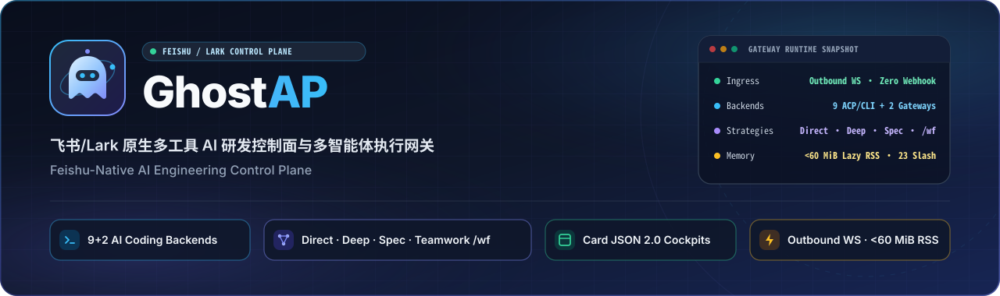
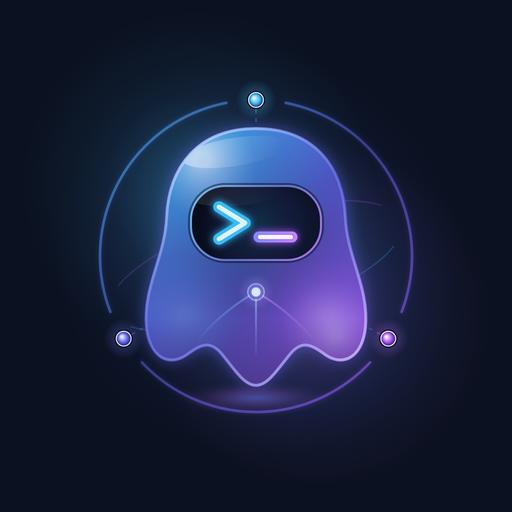
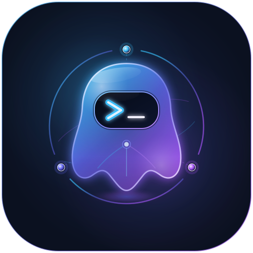
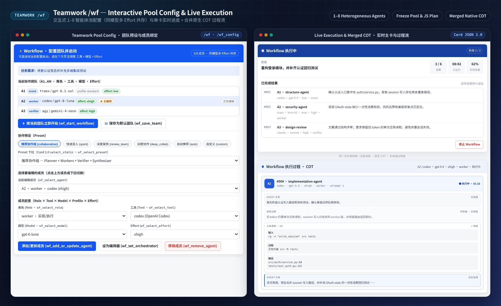
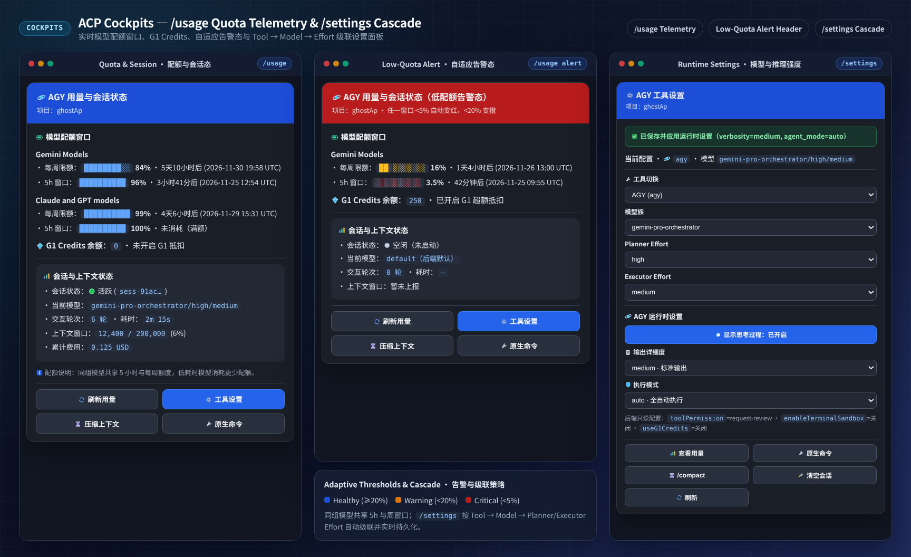
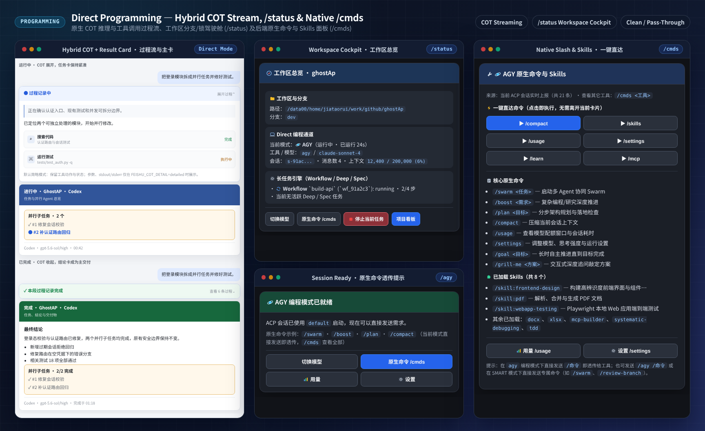
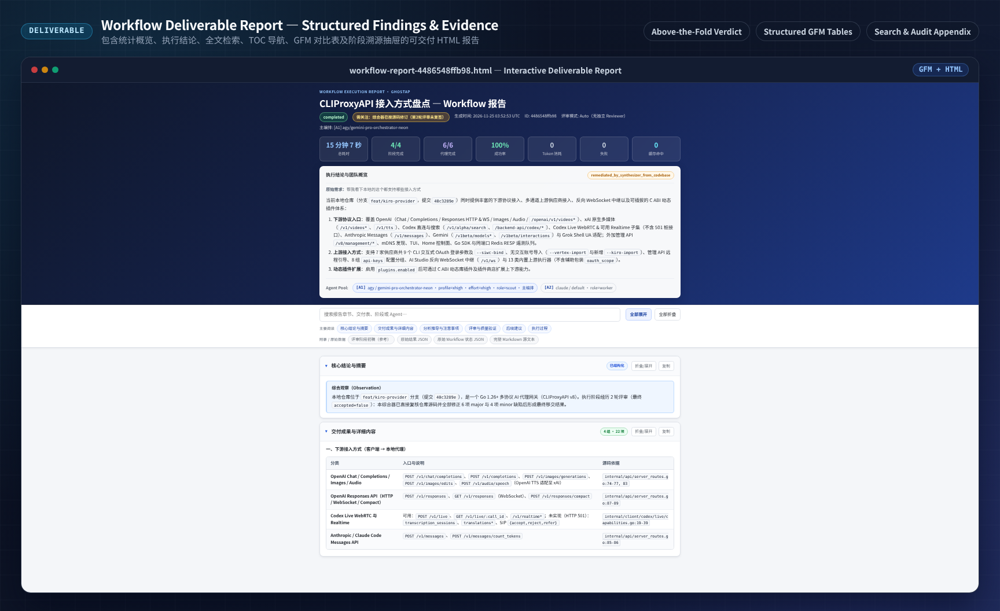
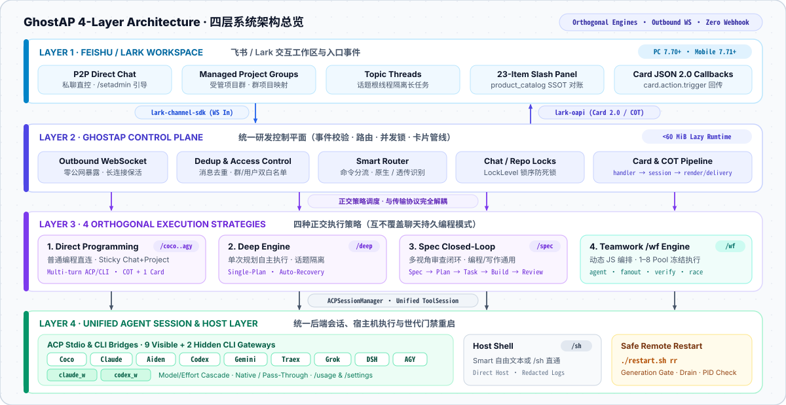
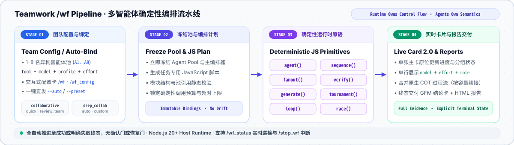

<p align="center">
  
</p>

<p align="center">
  <a href="CHANGELOG.md"></a>
  <a href="pyproject.toml"></a>
  <a href="LICENSE"></a>
  <a href=".github/workflows/ci.yml"></a>
  <a href="docs/adr-card-pipeline-boundary.md"></a>
  <a href="docs/product-contract.md"></a>
  <a href="install.sh"></a>
</p>

<p align="center">
  <a href="README.md">简体中文</a> | <strong>English</strong>
</p>

<p align="center">
  <a href="#highlights">Highlights</a> ·
  <a href="#ui-showcase">UI Showcase</a> ·
  <a href="#installation">Installation</a> ·
  <a href="#feishu-setup">Feishu Setup</a> ·
  <a href="#architecture--multi-agent-wf">Architecture &amp; /wf</a> ·
  <a href="#command-reference">Commands</a>
</p>

<p align="center">
  <a href="docs/assets/ghostap-avatar.png"></a>&nbsp;&nbsp;&nbsp;
  <a href="docs/assets/ghostap-icon.svg"></a>
  <br>
  <sub><b>Feishu Bot Avatar (512×512 circular-crop safe)</b> · <b>Vector Brand Icon (SVG)</b></sub>
</p>

> **GhostAP** is a Feishu/Lark-native AI engineering control plane and multi-agent execution gateway built for trusted engineering hosts. The **Main Bot** acts as the unified control plane for projects, managed chats, direct programming sessions, and long-running Deep / Spec / Teamwork `/wf` engines, while keeping underlying **provider/transport**, model selection, and execution strategy decoupled; see the [Product Contract](docs/product-contract.md) for authoritative boundaries.

---

## Highlights

| Capability | Summary |
| :--- | :--- |
| **Outbound WebSocket Ingress** | Connects out to Feishu/Lark over persistent WebSockets—zero public IP, domain, or inbound webhook server required. |
| **9+2 AI Backends & Clean `/` Pass-Through** | Drives `coco`, `claude`, `aiden`, `codex`, `gemini`, `traex`, `grok`, `dsh`, and `agy` (plus hidden CLI bridges `claude-w` and `codex-w`) with `/cmds` discovery and zero-prompt-pollution native `/` pass-through. |
| **4 Orthogonal Execution Strategies** | **Direct** multi-turn coding, **Deep** single-plan autonomous runs, **Spec** structured multi-role review loops, and **Teamwork `/wf`** multi-agent JS orchestration—topic-scoped without overwriting your persistent coding mode. |
| **Feishu Card 2.0 Cockpits** | Interactive `/usage` quota & credits meters, `/settings` cascading tool/model/effort cockpit, `/status` workspace cockpit, and hybrid streaming COT updates. |
| **Lazy `<60 MiB` Runtime** | On-demand hydration of `lark_oapi`, `lark_channel`, and heavy engines with zero idle polling (~`56.9 MiB` idle RSS, `3` resident threads measured). |
| **Generation-Fenced Remote Restart** | Run `./restart.sh rr` safely from inside a bot task; cross-process gates drain in-flight tasks and verify WebSocket readiness fingerprints before handoff. |

---

## UI Showcase

<table width="100%">
  <tr>
    <td width="50%" align="center" valign="top">
      <a href="docs/assets/showcase-workflow.png"></a><br>
      <sub><b>Teamwork <code>/wf</code> team config card &amp; live orchestration progress</b></sub>
    </td>
    <td width="50%" align="center" valign="top">
      <a href="docs/assets/showcase-cockpit.png"></a><br>
      <sub><b><code>/usage</code> quota meters &amp; <code>/settings</code> cascading model/effort cockpit</b></sub>
    </td>
  </tr>
  <tr>
    <td width="50%" align="center" valign="top">
      <a href="docs/assets/showcase-programming.png"></a><br>
      <sub><b>Hybrid streaming COT card, <code>/cmds</code> native panel &amp; <code>/status</code> overview</b></sub>
    </td>
    <td width="50%" align="center" valign="top">
      <a href="docs/assets/showcase-report.png"></a><br>
      <sub><b>Structured GFM / HTML Teamwork <code>/wf</code> deliverable report</b></sub>
    </td>
  </tr>
</table>

---

## Installation

### Prerequisites

- **OS**: Linux or macOS
- **Python 3.11+** and **`uv`** (automatically installed when missing by `install.sh` and `./restart.sh`)
- **Node.js 20+** (required for `/wf` Teamwork multi-agent orchestration)
- **Feishu / Lark Client**: PC `7.70+` / Mobile `7.71+` for the native Slash Command panel
- **Local AI CLIs**: Install and authenticate the coding agents/ACP providers you plan to drive (`coco`, `claude`, `codex`, `gemini`, `agy`, etc.)

### Three Deployment Options

#### 🚀 Option 1: Zero-Prerequisite One-Click Installer (Recommended)

Automatically installs `uv` + Python 3.11+ if missing, prepares the virtual environment, and initializes `.env` with `0600` permissions (see [install.sh](install.sh)):

```bash
curl -fsSL https://raw.githubusercontent.com/22-ai-00/ghostAp/main/install.sh | bash
```

> **Flags**: Defaults to the current GhostAP checkout or `~/ghostAp` (`GHOSTAP_INSTALL_DIR`); supports `--mode source|tool|wheel`, `--dir <path>`, `--wheel <path-or-url>`, `--repo <url>`, `--branch <name>`, and `--no-dev` (e.g., `curl ... | bash -s -- --mode tool`). Set `GHOSTAP_AUTO_INSTALL_UV=0` to disable automatic `uv` installation.

#### 📦 Option 2: Global CLI / Release Wheel (`uv tool` / `pipx`)

Download a `.whl` (alongside `install.sh` and `SHA256SUMS.txt`) from [GitHub Releases](https://github.com/22-ai-00/ghostAp/releases), or install globally via `install.sh --mode wheel` or Git:

```bash
# Install from release wheel
uv tool install ghostap-*.whl
# or: pipx install ghostap-*.whl

# Or auto-fetch the latest release wheel / install directly from Git
curl -fsSL https://raw.githubusercontent.com/22-ai-00/ghostAp/main/install.sh | bash -s -- --mode wheel
# or: uv tool install git+https://github.com/22-ai-00/ghostAp.git

# Verify version, initialize .env (0600), run diagnostics, and launch
ghostap --version
ghostap init          # Optional: --dir <path> --force
ghostap doctor        # Optional: --dir <path>
ghostap               # Or: ghostap run / ghostap validate
```

#### 🛠️ Option 3: Source Checkout & Daemon Script

```bash
git clone https://github.com/22-ai-00/ghostAp.git
cd ghostAp
./restart.sh install   # (or bootstrap) Bootstraps uv if missing, syncs deps, creates .env
vim .env               # Add APP_ID and APP_SECRET
./restart.sh start     # Starts in background and waits for WebSocket readiness
```

> Opt out of automatic `uv` installation with `GHOSTAP_AUTO_INSTALL_UV=0`, or skip dependency sync on startup with `GHOSTAP_SYNC_PYTHON_DEPENDENCIES=0`.

---

## Feishu Setup

### 1. 5-Minute Feishu Open Platform Checklist

1. Create an enterprise custom app in the [Feishu Open Platform](https://open.feishu.cn/app) and copy **`APP_ID`** and **`APP_SECRET`**.
2. Under **Events & Callbacks**, enable **Long Connection (Outbound WebSocket)**.
3. Subscribe to **`im.message.receive_v1`**.
4. Under **Callback Subscriptions**, keep **only** **`card.action.trigger`** (Card JSON 2.0; remove legacy `card.action.trigger_v1` — see the [Feishu card callback docs](https://open.larkoffice.com/document/feishu-cards/card-callback-communication)).
5. Grant IM send/receive and card update permissions.
6. Grant **`application:app_slash_command:read`** and **`application:app_slash_command:write`**, then **publish a new app version**.

> **Bot Avatar Tip**: Upload [`docs/assets/ghostap-avatar.png`](docs/assets/ghostap-avatar.png) directly as your Feishu Bot's avatar—it is sized at `512x512` with circular-crop safe margins (matching vector icon: [`docs/assets/ghostap-icon.svg`](docs/assets/ghostap-icon.svg)).
>
> **Slash Panel Sync**: On startup, GhostAP reconciles the 23 primary slash commands (expect ~5 min OpenAPI propagation + ~3 min client cache). Hidden commands and aliases like `/workflow` remain immediately usable when typed.

### 2. Minimal `.env` & Validation

```env
APP_ID=your_app_id
APP_SECRET=your_app_secret
DEFAULT_ACP_TOOL=coco
ADMIN_USER_IDS=
INGRESS_ACCESS_MODE=legacy_allow_all
ADMIN_BOOTSTRAP_SCOPE=p2p_only
```

See [`.env.example`](.env.example) and [`src/config/settings.py`](src/config/settings.py) for timeout, COT (`FEISHU_COT_ENABLED`, `FEISHU_COT_DETAIL`), and lock parameters. Validate and run:

```bash
ghostap validate && ghostap
# Or from source:
uv run python -m src.main --validate && uv run python -m src.main
```

Send **`/setadmin`** in a direct message (P2P) to the bot on first launch to bootstrap the initial admin (only allowed while `ADMIN_USER_IDS` is empty).

---

## Architecture & Multi-Agent `/wf`

<p align="center">
  
</p>

### Run Model

| Layer | Responsibility |
| :--- | :--- |
| **Main Bot** | Unified control plane for projects, managed chats, scheduling, lock ordering, access control, and delivery audit |
| **Execution Strategies** | Direct coding, Deep, Spec, and Teamwork `/wf` (the latter three scope to topics/root threads without changing chat+project coding mode) |
| **provider/transport** | Uniform session abstraction across ACP Stdio (`coco`, `aiden`, `codex`, `gemini`, `traex`, `grok`, `dsh`, `agy`) and CLI bridges (`claude`, `claude-w`, `codex-w`) |
| **Host Shell** | Direct host execution for unmatched Smart-mode shell commands or `/sh <cmd>` (not an Agent provider) |

### Teamwork `/wf` Multi-Agent Orchestration

<p align="center">
  
</p>

- **Interactive Config & Instant Launch**: `/wf <requirement>` opens a Teamwork config & launch card prefilled with the chat/project's saved team or auto-bound recommended Agent Pool (**1–8 `tool+model` Agents** with `A1`–`A8`, `profile`/`effort`/`role`). Use `/wf --auto <requirement>` or `/wf --preset <id> <requirement>` (`collaborative`, `quick`, `review_team`, `deep_collab`, `auto`, `custom`) to launch immediately.
- **Frozen Pool & Autonomous Progression**: Once launched, the pool and orchestrator freeze immediately; script generation, validation, and execution advance automatically to a terminal `COMPLETED`, `FAILED`, or `CANCELLED` state with no mid-run confirmation gates.
- **Deterministic JS Primitives**: Runs on **Node.js 20+**, composing `classify`, `agent()`, `sequence()`, `fanout()`, `verify()`, `generate()`, `tournament()`, `loop()`, and `race()`. Scripts can invoke only bound pool IDs and cannot override frozen tool/model bindings.
- **Live Cards & Rich Reports**: Live progress stays concise with one active line per agent and outputs structured GFM Markdown + searchable standalone HTML reports. Run `/wf_help` or `/workflow_help` anytime for inline help.

### Card 2.0 Pipeline

Card delivery enforces strict unidirectional imports (see [ADR: Card Pipeline Boundary](docs/adr-card-pipeline-boundary.md)):

```text
handler -> session -> render
                  -> delivery
```

---

## Command Reference

### Modes & Models

| Command | Purpose |
| :--- | :--- |
| `/help` · `/menu` | Interactive help categories or quick action menu |
| `/tools` · `/tools_status` | List supported AI backends and inspect host availability |
| `/coco` · `/claude` · `/aiden` · `/codex` · `/gemini` · `/traex` · `/grok` · `/dsh` · `/agy` | Enter persistent coding mode (hidden bridges `/claude-w`, `/codex-w` also callable explicitly) |
| `/<tool> <prompt or native cmd>` | One-shot execution routed directly to the target backend |
| `/cmds [tool]` | Open native `/` commands & loaded Skills panel with 1-click no-arg triggers |
| `/usage [tool]` | View quota bars, G1 Credits, and live session telemetry (aliases `/quota`, `/credits`, `/cost`) |
| `/settings [tool]` | Open cascading tool/model/profile/effort & AGY runtime settings cockpit (alias `/config`) |
| `/model [name\|default]` · `/effort [level\|default]` | Inspect or hot-switch active model and thinking effort |
| `/acp [tool]` | Inspect or switch project default ACP tool |
| `/coco_info`, `/claude_info`, `/aiden_info`, `/codex_info`, `/gemini_info`, `/traex_info`, `/grok_info`, `/dsh_info`, `/agy_info`, `/info` | Inspect session, active model, and context metrics for each backend |
| `/stop` · `/clear` · `/btw <question>` | Stop running task (keeps mode) / reset context (keeps model) / side question |
| `/sh <cmd>` · `/ask <tool> <question>` · `/exit` | Run host shell / zero-side-effect side query / return to Smart mode |

### Projects & Workspace

| Command | Purpose |
| :--- | :--- |
| `/projects` | Open managed projects board |
| `/new <name> [dir]` · `/new-chat <name> [suffix] [dir]` | Register a project or create/bind a dedicated project chat |
| `/switch <name>` · `/close <name>` | Switch active project or close project |
| `/status [task_id]` | Workspace cockpit (repo, branch, engines, locks) or task details |
| `/tasks` · `/diff` · `/trace <msg_id>` | Task board, recent git diff summary, or message trace |
| `/lock` · `/unlock` · `/setadmin [user_id]` | Admin chat lock controls and initial admin bootstrap |

### Long-Running Engines

| Command | Purpose |
| :--- | :--- |
| `/deep <goal>` · `/deep_status` · `/deep_update <note>` · `/stop_deep` | Start, inspect, steer, or stop Deep Engine |
| `/spec <goal>` · `/spec_status` · `/spec_guide <note>` · `/stop_spec` | Start, inspect, or guide Spec Engine (`/spec_history`, `/spec_metrics`, `/spec_config`, `/spec_export`, `/spec_save`) |
| `/wf <goal>` · `/wf --auto <goal>` · `/wf --preset <id> <goal>` | Open Teamwork config card or launch immediately |
| `/wf_config` · `/wf_status` · `/wf_help` · `/stop_wf` | Configure chat/project team defaults, inspect progress, view help, or stop |
| `/workflow` · `/workflow_config` · `/workflow_status` · `/workflow_help` · `/stop_workflow` | Long-form Workflow command aliases |

---

## Operations & Development

<details>
<summary><b>Expand: Generation-Fenced Safe Remote Restart (<code>./restart.sh rr</code>)</b></summary>

Trigger `./restart.sh rr` from within a running bot task to safely restart the checkout:

- **Pre-flight & Gate**: Pins the current generation, blocks new ingress via an out-of-checkout lock gate (`.ghostap-restart-gates/<checkout-hash>/gate`, overridable via `GHOSTAP_RESTART_GATE_DIR` to a private user-owned path), and drains active tasks before stopping.
- **Bounded Budget & Fingerprinted Readiness**: Runs inside a detached worker with a 7200s default timeout (`GHOSTAP_RESTART_GATE_TIMEOUT`), 30s graceful stop window, and publishes ready status only after WebSocket connection + exact PID/fingerprint match.

</details>

- **Security Model**: Host Shell, ACP, and Workflow run directly with host OS permissions (see [SECURITY.md](SECURITY.md)). Enable `INGRESS_ACCESS_MODE=enforced` and `0600` `.env` permissions for multi-user environments.
- **Development Workflow** (`uv` only):

```bash
uv sync --group dev
uv run python -m src.main --validate
uv run ruff check src/ tests/ scripts/
uv run python scripts/test_inventory.py tests/
uv run python -m pytest tests/ -q -m "not slow"
```

See [AGENTS.md](AGENTS.md), [Testing Guide](docs/testing.md), [Commit Guidelines](docs/commit-message-guidelines.md), [Lock Ordering ADR](docs/adr-lock-ordering.md), and [CHANGELOG.md](CHANGELOG.md).

---

## Contributing & License

Contributions are welcome! Please read [CONTRIBUTING.md](CONTRIBUTING.md) and [SECURITY.md](SECURITY.md) before opening a PR.

Licensed under the [MIT License](LICENSE).
